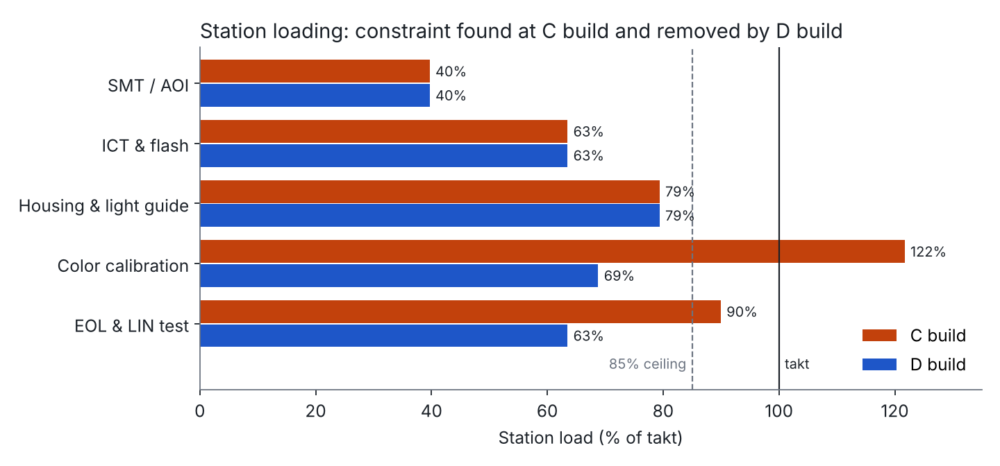
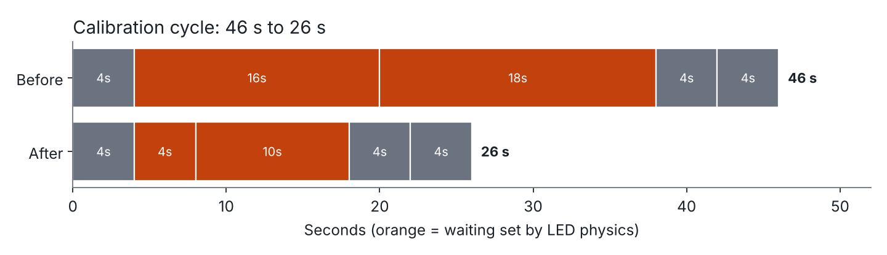
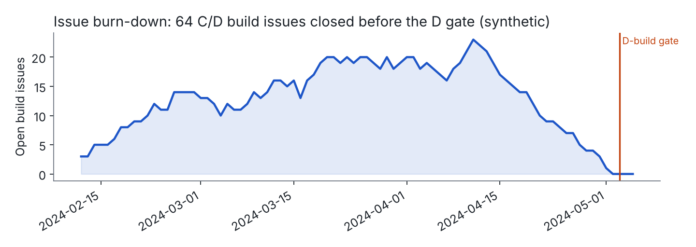

# NPI Launch Toolkit

**Line balancing, build readiness, and first-principles checks for launching hardware into semi-automated production.**

I built these tools while leading NPI launches of automotive electronics from design freeze through C/D builds, SOP, and post-launch changes. This repo reproduces the methods on one launch, an **interior ambient-lighting ECU at 500,000 units/year**, using **synthetic data**. No customer or employer data is included.

> **Case study result:** the line went from ~1,590 to 2,000+ units/day at run-at-rate without new capital equipment, 8 weeks of schedule were recovered, and SOP held on the committed vehicle-launch date.

---

## The launch in one page

| | |
|---|---|
| **Product** | Interior ambient-lighting ECU: MCU, LIN transceiver, RGB LED driver and RGB LED, with a PMMA light guide in a PC/ABS housing that clips into door and dash trim |
| **Volume** | 500,000 units/year → 2,000/day → **37.8 s takt** (2 shifts × 10.5 net h) |
| **My scope** | NPI program lead from design freeze: C/D builds, ramp, SOP, post-launch engineering changes |
| **Problems at C build** | MCU on allocation (8 weeks behind) · calibration station at 122% load · 4% clip cracking at OEM trim install |

### 1. Find the real constraint: math first, then the floor



`load = cycle time ÷ takt`. Color calibration was at **122%**, which limits the line to 75,600 s ÷ 46 s = **1,643 units/day**. At C-build run-at-rate the line made ~1,590/day, which is the model's prediction × 97% uptime. Work queued in front of calibration while end-of-line test sat starved. That confirmed the model had found the real constraint.

### 2. Remove it with physics, not equipment



34 of the 46 seconds were waiting time, and both waits came from LED physics:

- **Warm-up (16 s):** red AlInGaP LEDs lose roughly 0.5–1% of their light output per kelvin as they warm up, much faster than green and blue, so the measured color drifts during warm-up. Instead of waiting for steady state, the fix calibrates at a **known** temperature, using LED forward voltage (about −2 mV/K) as a thermometer, and applies the firmware's own temperature-compensation table.
- **Measurement (18 s):** for the same signal-to-noise, integration time scales as 1 ÷ brightness, so a 10%-brightness point takes about 10× longer to measure. PWM dimming is linear in duty cycle, so the fix measures at full brightness only, keeps one low-light verification point, and runs a full linearity audit on 1 in 50 units.

The cycle dropped from **46 to 26 s**. The constraint then moved to end-of-line test at 90%, which dropped from **34 to 24 s** by testing LED channels in parallel. No second calibration station was bought.

### 3. Settle design-vs-production with data

Clip strain for a cantilever snap is `ε = 1.5·y·t / L²`:

| Case | Deflection | Strain | PC/ABS allowable |
|---|---|---|---|
| Nominal | 1.2 mm | 2.16% | ~2.5% → passes |
| Worst-case stack (tight trim hole + thick clip) | 1.6 mm | **2.88%** | fails |

CMM data on 30 trim panels and 30 housings showed that every crack came from the worst-case stack combined with a molding weld line at the clip root. Design proposed a material change (new tool plus interior re-qualification: 10 weeks). Production proposed a larger trim hole, which meant changing another supplier's tool and risking rattles. The fix was a **steel-safe mold change**: move the gate and add a root radius. It took 2 weeks and took cracking from **4% to 0**.

### 4. Run C/D builds through a material shortage



- **Clear-to-build:** checks every critical part against every planned build, net of the parts earlier builds consumed (`readiness.clear_to_build`).
- **Allocation:** scarce MCUs went first to builds that gate validation and customer trials (`readiness.allocate`).
- **Issue tracking:** one log with owners and closure criteria, burned down to zero before the D-build gate (`readiness.issue_burndown`).

---

## Results

| Metric | Before | After |
|---|---|---|
| Line output (units/day) | ~1,590 | **2,000+** |
| Calibration cycle | 46 s | **26 s** (−43%) |
| Clip cracking at OEM install | 4% | **0** |
| Schedule | 8 weeks behind | **SOP on date** |
| New capital equipment | 2nd calibration station planned | **none** |
| Post-launch LED second-source change | – | **0 units lost** |

---

## Repo structure

```
npi_toolkit/
  line_balance.py   takt, station loading, constraint, floor check
  readiness.py      clear-to-build, allocation by priority, issue burn-down
  physics.py        snap-fit strain, stack-up (worst case / RSS), LED drift,
                    integration time, thermal time constant, Little's Law
data/               synthetic stations, BOM, inventory, build plan, issues
examples/run_all.py reproduces every number and chart in this README
docs/               generated charts and sample output
```

## Run it

```bash
pip install -r requirements.txt
python examples/run_all.py
```

Sample output: [`docs/sample_output.txt`](docs/sample_output.txt)

## Notes

- All data is synthetic and representative; the physics constants are typical published values, not product data.
- These are planning models. Every conclusion was confirmed on the floor or in validation before the line changed.

---

**Vivek Selvakumar** · Senior Program Manager, NPI & Operations · [linkedin.com/in/vivekselva](https://www.linkedin.com/in/vivekselva/)
